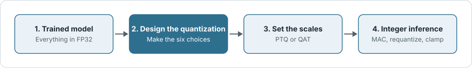
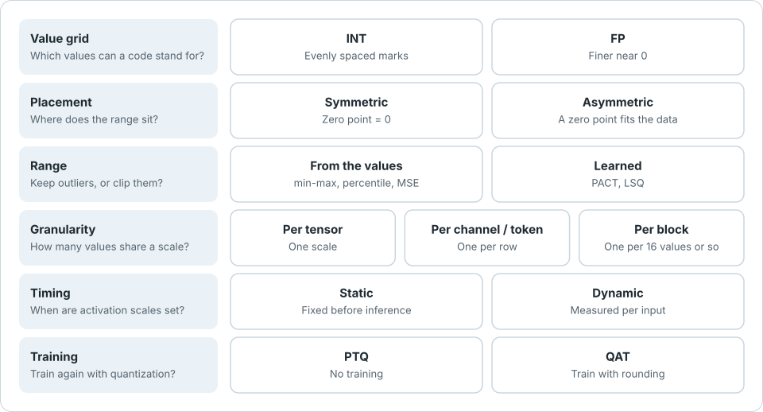

# What is quantization?

> Why we store and compute AI models with fewer bits, and a map of everything quantization decides.

A trained model holds millions of numbers: the weights, and the activations that flow between its layers. PyTorch stores each of them as a 32-bit float (FP32). Quantization stores them with fewer bits instead, such as 8-bit integers (INT8) or 4-bit numbers.

## Why fewer bits

| | FP32 | INT8 | INT4 |
|---|---|---|---|
| Bits for one number | 32 | 8 | 4 |
| 1 million weights | 4 MB | 1 MB | 0.5 MB |
| Numbers in one 32-bit memory read | 1 | 4 | 8 |

- **Less memory.** The model is 4 times smaller in INT8, and 8 times smaller in INT4. It can fit in the small memory of a microcontroller or an FPGA.
- **Less data to move.** Reading memory often costs more time and power than the math itself. With fewer bits, each read brings more numbers.
- **Cheaper math.** An 8-bit integer multiplier is much smaller and uses much less power than a 32-bit float multiplier. A chip can fit many of them side by side, and run them at once.

This is why quantization is used to run models on embedded devices, and also to make large language models cheaper to train and run.

## What it costs

With 8 bits, there are only 256 different values (with 4 bits, only 16). Every real number must be replaced by one of them, so it changes a little. These small changes add up through the layers, and the accuracy of the model can drop.

The art of quantization is to choose which values the codes can stand for, so that the model keeps its accuracy. These choices fall into the six groups shown in the next section.

## The big picture

A quantized model goes through four stages, from the trained model to the device.

Stage 2, "Design the quantization", makes these six choices. Each row has the name of the choice on the left, and its options on the right.

The six choices are not independent. The fewer values a format has (as at 4 bits), the more FP formats, finer granularity, and QAT are worth. And a device that runs on integers only usually avoids the choices that add work at run time (asymmetric weights, dynamic scales).

What each choice changes, and where it is explained:

| Choice | Options | What it changes | Page |
|---|---|---|---|
| Value grid | INT (evenly spaced) / FP (finer near 0) | How finely a bell-shaped distribution is covered | [Scale and zero point](02-scale-zero-point.md), [INT and FP formats](08-int-fp.md) |
| Placement | Symmetric (zero point 0) / Asymmetric (moved by a zero point) | Wasted codes, and extra integer math | [Symmetric](03-symmetric.md), [Asymmetric](04-asymmetric.md) |
| Range | From the values (min-max, ...) / Learned (LSQ, ...) | The balance of rounding and clipping errors | [Choosing the range](06-clipping-range.md) |
| Granularity | Per tensor / per channel or token / per block | The number of scales, and how well they fit values of different sizes | [Granularity](07-granularity.md), [Block scales](09-block-scales.md) |
| Timing | Static (before inference) / Dynamic (per input) | Run-time work, and how well the scales follow the input | [Static and dynamic](../02-setting-scales/10-static-dynamic.md) |
| Training | PTQ (no training) / QAT (train with rounding) | Effort, and accuracy at low bit widths | [PTQ](../02-setting-scales/11-ptq.md), [QAT](../02-setting-scales/12-qat.md) |

Three typical combinations:

| Example | Value grid | Placement | Granularity | Timing | Training |
|---|---|---|---|---|---|
| INT8 on a microcontroller | INT | Weights symmetric, activations asymmetric | Weights per channel, activations per tensor | Static | PTQ (QAT if needed) |
| 4 bits (NVFP4) | FP | Symmetric | Per block | Block scales dynamic, tensor scale static | QAT |
| LLM on a server (INT8) | INT | Symmetric | Weights per channel, activations per token | Dynamic | PTQ |

## Integer-only inference

On a device with integer hardware, quantization goes one step further: every layer computes with integers only, from the input image to the output. The device never needs a float. [Integer inference](../03-integer-math/14-integer-inference.md) and [Requantization](../03-integer-math/15-requantization.md) show how.

## How to read these notes

The pages are meant to be read in order:

1. [Quantization basics](README.md) (this section): the rule that turns a real number into an integer, and the value grid, placement, range, and granularity.
2. [Setting the scales](../02-setting-scales/README.md): timing and training.
3. [Integer math on the device](../03-integer-math/README.md): the steps that run a quantized model with integers only.
4. [Quantized layers](../04-quantized-layers/README.md): ReLU, residual adds, pooling, and attention in integer math.

---

[Index](../README.md) | Next: [Scale and zero point](02-scale-zero-point.md) →
