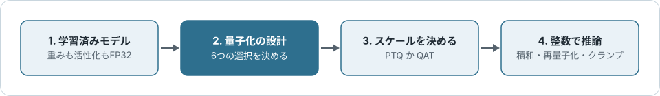
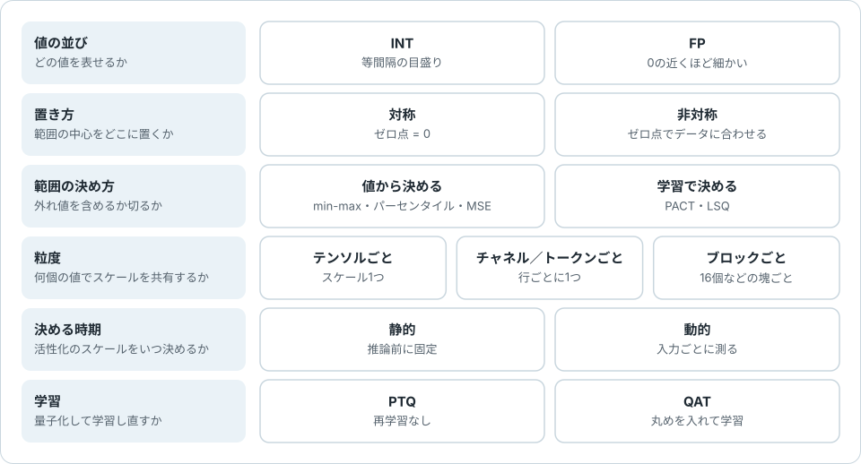

# 量子化とは

> モデルを少ないビット数で持つと何がうれしいのか、その代わりに何を決めなければならないのか。

学習を終えたニューラルネットワークは、重みと、層から層へ渡る活性化という、数百万個の数でできている。PyTorchではこれらを32ビットの浮動小数点数（FP32）で持つのが普通である。量子化とは、これを8ビット整数（INT8）や4ビットの数のように、もっと少ないビット数で表すことをいう。

## ビット数を減らすと何がうれしいか

| | FP32 | INT8 | INT4 |
|---|---|---|---|
| 1個の数に使うビット数 | 32 | 8 | 4 |
| 重み100万個の大きさ | 4 MB | 1 MB | 0.5 MB |
| 32ビットのメモリ読み出し1回で届く数 | 1 | 4 | 8 |

うれしいことは大きく3つある。

- **メモリに収まる。** INT8ならモデルは4分の1、INT4なら8分の1になる。マイコンやFPGAの小さなメモリにも載せられる。
- **データの移動が減る。** 実際の機器では、計算そのものよりメモリからの読み出しの方が時間も電力も食うことが多い。1個あたりのビット数が少なければ、1回の読み出しで多くの数を運べる。
- **計算器が小さくなる。** 8ビット整数の乗算器は、32ビット浮動小数点数の乗算器よりずっと小さく、消費電力も少ない。同じ面積に多くの乗算器を並べ、同時に動かせる。

組み込み機器でモデルを動かすときにも、大規模言語モデルの学習や推論の費用を下げたいときにも量子化が使われるのは、このためである。

## 代わりに失うもの

8ビットで表せる値は256種類、4ビットなら16種類しかない。どの実数も、その中のどれかに置き換えることになるので、値は少しずつずれる。ずれは層を通るたびに積み重なり、モデルの精度を下げる。

そのため量子化では、「限られた数のコードに、どの実数を割り当てるか」をうまく決めることが中心になる。決めることは、次の節で示す6つに整理できる。

## 全体像

学習済みのモデルは、次の4段階を経てデバイスで動く。

このうち2段階目の「量子化の設計」で決めるのが、次の6つである。各行の左が決めること、右がその選択肢を表す。

6つはそれぞれ別の問題だが、互いに影響し合う。たとえば4ビットのように表せる値が少ないときほど、FP形式、細かい粒度、QATを選ぶ利点が大きくなる。逆に、整数演算だけで推論したいデバイスでは、実行時の処理が増える選択（重みを非対称にする、スケールを動的にする）は避けられることが多い。

各選択で何が変わるのかと、詳しく説明しているページを次の表にまとめる。

| 決めること | 選択肢 | 何が変わるか | ページ |
|---|---|---|---|
| 値の並び | INT（等間隔）／FP（0の近くほど細かい） | 0の近くに集まった値をどれだけ細かく表せるか | [スケールとゼロ点](02-scale-zero-point.md)、[INT形式とFP形式](08-int-fp.md) |
| 置き方 | 対称（ゼロ点が0）／非対称（ゼロ点でずらす） | 使われないコードの量と、整数演算の手間 | [対称量子化](03-symmetric.md)、[非対称量子化](04-asymmetric.md) |
| 範囲の決め方 | 値から決める（min-maxなど）／学習で決める（LSQなど） | 丸め誤差とクリップ誤差のどちらを優先するか | [範囲の選び方](06-clipping-range.md) |
| 粒度 | テンソルごと／チャネル・トークンごと／ブロックごと | スケールの数と、大きさの違う値への対応 | [粒度](07-granularity.md)、[ブロックスケール](09-block-scales.md) |
| 決める時期 | 静的（推論前に固定）／動的（入力ごとに測る） | 実行時の処理量と、入力の変化への追従 | [静的スケールと動的スケール](../02-setting-scales/10-static-dynamic.md) |
| 学習 | PTQ（再学習しない）／QAT（丸めを入れて学習する） | 準備の手間と、低ビットでの精度 | [PTQ](../02-setting-scales/11-ptq.md)、[QAT](../02-setting-scales/12-qat.md) |

実際によく使われる組み合わせを3つ挙げる。

| 例 | 値の並び | 置き方 | 粒度 | 決める時期 | 学習 |
|---|---|---|---|---|---|
| マイコン向けのINT8 | INT | 重みは対称、活性化は非対称 | 重みはチャネルごと、活性化はテンソルごと | 静的 | PTQ（足りなければQAT） |
| 4ビット（NVFP4） | FP | 対称 | ブロックごと | ブロックのスケールは動的、テンソルのスケールは静的 | QAT |
| サーバで動かすLLM（INT8） | INT | 対称 | 重みはチャネルごと、活性化はトークンごと | 動的 | PTQ |

## 整数だけで推論する

整数演算の回路しか持たないデバイスでも、量子化したモデルなら動かせる。入力から出力まで、すべての層を整数だけで計算できるからである。その手順は[整数推論](../03-integer-math/13-integer-inference.md)と[再量子化](../03-integer-math/14-requantization.md)で説明する。

## 読み進め方

このノートは、先頭から順に読むことを想定して書いている。

1. [量子化の基礎](README.md)（このセクション）：実数を整数に置き換える規則と、「値の並び」「置き方」「範囲」「粒度」の決め方。
2. [スケールの決め方](../02-setting-scales/README.md)：「決める時期」と「学習」。
3. [デバイス上の整数演算](../03-integer-math/README.md)：量子化したモデルを整数だけで動かす手順。
4. [量子化した層](../04-quantized-layers/README.md)：ReLU、残差加算と共有スケール、プーリング、attentionを整数で計算する方法。

---

[目次](../README.md) ｜ 次: [スケールとゼロ点](02-scale-zero-point.md) →
